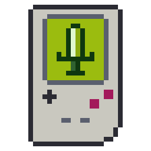

# Aragorn

Rust로 만든 게임보이 / 게임보이 컬러 에뮬레이터입니다.

- **목표:** 포켓몬 레드·블루·옐로·골드·실버·크리스탈을 끝까지 즐길 수 있게 하는 것
- **지원 OS:** Windows, macOS, Linux, Android, iOS(사이드로딩)
- **자동 업데이트:** GitHub Releases에서 서명된 업데이트를 받습니다.

> ROM은 들어 있지 않습니다. 직접 가지고 있는 카트리지에서 추출한 ROM을 사용해 주세요.

## 주요 기능

- **DMG·CGB 에뮬레이션:**
  - CPU(SM83), PPU, APU, 타이머, OAM DMA, HDMA, CGB 2배속을 지원합니다.
  - 카트리지는 ROM 전용, MBC1, MBC3(+RTC), MBC5를 지원합니다.
- **배터리 세이브:**
  - ROM 옆에 `.sav`로 저장합니다. 형식은 BGB·VBA-M·mGBA와 호환됩니다.
  - 그 실행에서 처음 저장하기 직전의 세이브를 `.sav.bak`으로 남깁니다.
- **RTC(게임 속 시계):** 골드·실버·크리스탈의 시계가 앱을 꺼도 실제 시간에 맞춰 흐릅니다.
- **세이브 스테이트:** 슬롯 10개를 쓸 수 있고, 슬롯마다 썸네일이 붙습니다.
- **배속·일시정지:** 기본 속도를 1배, 2배, 4배 중에서 고를 수 있습니다. 배속 키를 누르고 있는 동안에는 2배, 4배 또는 무제한 속도로 돕니다.
- **되감기:** 되감기 키(R)나 화면의 되감기 버튼을 누르는 동안 최근 약 20초를 거꾸로 돌립니다. 설정에서 끌 수 있습니다.
- **치트:** 게임 지니와 게임샤크 코드를 게임마다 저장해 켜고 끕니다.
- **화면 필터:** 흑백 게임 팔레트(연두, 원래 게임보이, 게임보이 포켓, 흑백), 컬러 게임 색 보정, LCD 격자.
- **최근 게임:** 최근에 연 게임 10개를 툴바 메뉴와 시작 화면에서 바로 엽니다.
- **이어하기:** 게임을 닫을 때의 자리를 남기고, 다시 열면 그 자리에서 이어서 합니다. 그 뒤로 세이브 파일이 바뀌었으면(다른 기기에서 가져온 세이브 등) 세이브 파일을 지키려고 이어하지 않습니다.
- **스크린샷:** F12나 툴바 "스크린샷"으로 지금 화면을 3배 크기 PNG로 사진 폴더의 `Aragorn/`에 저장합니다.
- **음소거:** 툴바의 "음소거"나 M 키로 켜고 끕니다. 다음 실행에도 유지됩니다.
- **키 설정·게임패드:** 키보드와 게임패드를 모두 다시 지정할 수 있습니다. 게임패드는 자동으로 인식합니다.
- **디버거:**
  - CPU 창: 레지스터, 디스어셈블리, 명령·프레임 단위 실행, PC 브레이크포인트
  - 메모리 창: 16진수 뷰어
  - VRAM 창: 타일, 배경·윈도우 맵, 스프라이트(OAM), CGB 팔레트
  - I/O 창: 레지스터, 소리 채널별 음소거
- **업데이트:**
  - 새 버전이 나오면 알림을 띄우고(소프트 업데이트), 백그라운드에서 받아 둘 수 있습니다(자동 다운로드).
  - 치명적 결함이 있는 버전은 업데이트를 강제합니다(강제 업데이트).
  - 업데이트 정책 파일은 Ed25519로 서명되어 있습니다.

## 설치

[Releases](https://github.com/dongjay00/aragorn/releases/latest)에서 운영체제에 맞는 파일을 받습니다.

| OS | 설치형 | 포터블 |
|---|---|---|
| Windows | `Aragorn-win-Setup.exe` | `Aragorn-win-Portable.zip` |
| macOS | `Aragorn-osx-Setup.pkg` | `Aragorn-osx-Portable.zip` |
| Linux | `Aragorn.AppImage` | — |
| Android (8.0 이상, 64비트) | `Aragorn-<버전>.apk` | — |
| iOS (17 이상) | `Aragorn-<버전>.ipa` (서명하지 않음, AltStore·SideStore로 설치) | — |

- 아직 코드 서명을 하지 않았습니다. 그래서 처음 실행할 때 경고가 뜹니다.
  - **Windows:** SmartScreen 경고에서 "추가 정보 → 실행"을 누릅니다.
  - **macOS:** Gatekeeper가 실행을 막습니다. macOS 15(Sequoia)부터는 Finder에서 우클릭한 뒤 "열기"를 눌러도 열리지 않습니다. 아래 방법 중 하나를 씁니다.
    - 설치 파일이나 앱을 한 번 열어 경고를 띄운 뒤 닫습니다. 그다음 "시스템 설정 → 개인정보 보호 및 보안" 맨 아래에서 "그래도 열기"를 누릅니다.
    - 포터블 zip을 쓴다면 압축을 푼 앱의 격리 속성을 지웁니다(`xattr -dr com.apple.quarantine Aragorn.app`). "손상되었기 때문에 열 수 없습니다"라는 경고가 뜰 때도 이렇게 합니다.
- Linux에서는 AppImage에 실행 권한을 줍니다(`chmod +x Aragorn.AppImage`).
- Android에서는 APK를 받아 엽니다. 처음에는 브라우저(또는 파일 앱)에 "출처를 알 수 없는 앱 설치"를 허용해야 합니다.
  - 새 버전이 나오면 앱이 알려 주고 릴리스 페이지를 엽니다. 받은 APK를 열면 기존 앱 위에 설치되고 세이브도 그대로입니다.
  - ROM은 앱의 "ROM"에서 고릅니다. 세이브는 데스크톱과 같은 형식(`.sav`, `.ss0`–`.ss9`)으로 저장합니다.
  - 세이브 폴더가 파일 앱에 "Aragorn"으로 보입니다. 데스크톱 세이브를 ROM 파일 이름에 맞춰 복사해 넣으면 이어서 할 수 있습니다.
- iOS 앱은 App Store에 없습니다. 서명하지 않은 IPA를 [AltStore](https://altstore.io)나 [SideStore](https://sidestore.io)로 자기 Apple ID로 서명해 설치합니다.
  - 무료 Apple ID로 서명한 앱은 7일마다 다시 서명해야 합니다. AltStore·SideStore가 백그라운드에서 처리합니다.
  - IPA는 이 저장소의 릴리스에서만 받으세요. 릴리스의 `update-policy.json`(서명됨)에 IPA의 SHA256이 들어 있습니다.
  - 세이브는 파일 앱의 "나의 iPhone › Aragorn › saves"에 보입니다.

## 사용법

- 툴바의 "ROM 열기"로 `.gb`/`.gbc` 파일을 엽니다. `aragorn <ROM 경로>`로 실행하면 그 ROM을 바로 엽니다.
- 같은 ROM을 다시 열면 `.sav`에서 이어서 합니다.
- 툴바 "최근 게임"이나 시작 화면의 목록에서 최근에 연 게임을 바로 엽니다.
- 툴바 "치트"에서 코드를 더합니다. 여러 코드를 `+`로 이으면 한 치트로 켜고 끕니다.

### 기본 키

| 기능 | 키보드 | 게임패드 |
|---|---|---|
| 방향 | 방향키 | D-pad |
| A / B | X / Z | 남쪽 / 동쪽 버튼 |
| Start / Select | Enter / Backspace | Start / Select |
| 배속 (누르는 동안) | Tab | 오른쪽 트리거 |
| 되감기 (누르는 동안) | R | 왼쪽 트리거 |
| 일시정지 | Esc | — |
| 음소거 켜기/끄기 | M | — |
| 스테이트 저장 / 불러오기 | F1–F10 / Shift+F1–F10 | — |
| 스크린샷 | F12 | — |

- 툴바 "설정"에서 키를 바꿀 수 있습니다. F1–F10은 스테이트 단축키라 게임 버튼으로 지정할 수 없습니다.
- 기본 속도(1배, 2배, 4배)와 배속 키를 눌렀을 때의 속도(2배, 4배, 무제한)도 설정에서 고릅니다.
  - 배속 키를 누르면 둘 중 빠른 속도로 돕니다.
  - 2배·4배에서는 소리가 그만큼 빠르고 높게 들립니다. 무제한에서는 소리가 나지 않습니다.

### 파일 위치

| 파일 | 위치 |
|---|---|
| 배터리 세이브 | ROM과 같은 폴더의 `<ROM 이름>.sav` (`.sav.bak` 백업) |
| 세이브 스테이트 | ROM과 같은 폴더의 `<ROM 이름>.ss0`–`.ss9` (슬롯 1–10, `.thumb` 썸네일 포함) |
| 치트 목록 | ROM과 같은 폴더의 `<ROM 이름>.cht` (JSON) |
| 이어하기 | ROM과 같은 폴더의 `<ROM 이름>.ssr` |
| 설정 | OS 설정 폴더의 `Aragorn/config.toml` (Linux: `~/.config/Aragorn/`, Windows: `%APPDATA%\Aragorn\config\`, macOS: `~/Library/Application Support/Aragorn/`) |

## 소스에서 빌드

필요한 것은 아래와 같습니다.
- **Rust:** stable 1.99 이상 (edition 2024)
- **Linux 추가 패키지:** `libasound2-dev`(ALSA), `libudev-dev`(게임패드)
  - 예: `sudo apt install libasound2-dev libudev-dev`
  - linuxbrew의 pkg-config를 쓰고 있다면 `PKG_CONFIG_PATH=/usr/lib/x86_64-linux-gnu/pkgconfig`를 설정합니다.

```bash
cargo run --release -p aragorn-desktop -- path/to/game.gbc
```

### 테스트

```bash
scripts/fetch-test-roms.sh   # 테스트 ROM을 tests/roms/에 내려받습니다 (커밋 고정 + SHA256 검증)
cargo fmt --all --check
cargo clippy --workspace --all-targets -- -D warnings
ARAGORN_REQUIRE_TEST_ROMS=1 cargo test --workspace
```

- 단위 테스트와 함께 아래 테스트 ROM이 `cargo test`로 자동 검증됩니다.
  - Blargg `cpu_instrs`, `instr_timing`, `mem_timing`, `dmg_sound`, `cgb_sound`
  - `dmg-acid2`, `cgb-acid2`
  - 선별된 mooneye-test-suite
- `ARAGORN_REQUIRE_TEST_ROMS`가 없으면 ROM이 없는 테스트는 건너뜁니다. CI에서는 설정합니다.

## 구조

Clean Architecture를 따라 세 크레이트로 나눴습니다.

| 크레이트 | 역할 |
|---|---|
| `crates/gb-core` | 순수 에뮬레이션 코어. 입출력·OS 의존성이 없습니다. |
| `crates/aragorn-app` | 세션, 설정, 속도 제어, 업데이트 정책 판단, 디버거 데이터 가공. 포트(트레이트)만 정의합니다. |
| `crates/aragorn-desktop` | egui/eframe UI, cpal 오디오, gilrs 게임패드, 파일 저장, Velopack 업데이트 어댑터 |
| `xtask` | 릴리스 도구: 서명 키 생성(`gen-key`), 정책 서명(`make-policy`), 태그·버전 확인(`check-tag`) |

## 문서

- [설계 스펙](docs/superpowers/specs/2026-10-07-gameboy-emulator-design.md): 목적과 범위, 아키텍처, 마일스톤
- [구현 계획](docs/superpowers/plans/): 마일스톤별 계획
- [남은 작업](docs/backlog.md): 직접 확인할 것, 미뤄 둔 문제, 범위 밖 기능, 릴리스 순서

## 릴리스

- `vX.Y.Z` 태그를 푸시하면 GitHub Actions가 3개 OS용 패키지를 만듭니다.
- 업데이트 정책(`release/policy.toml`)에 서명해 릴리스에 올립니다.
- 자세한 순서는 [남은 작업 §4](docs/backlog.md#4-다른-컴퓨터에서-이어서-작업할-때)에 있습니다.
- 서명 비밀 키는 저장소에 넣지 않습니다.

## 라이선스

[MIT](LICENSE)
